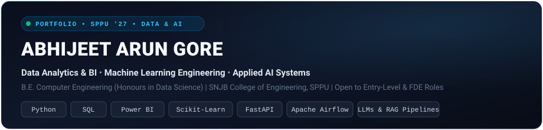

# Abhijeet Arun Gore
### **Data Analytics & BI • Machine Learning Engineering • Applied AI Systems**

---

## 📌 Executive Summary

Final-year Computer Engineering undergraduate pursuing Honours in Data Science at Savitribai Phule Pune University (Class of 2027). I bridge the gap between deterministic data analytics, production machine learning, and applied AI workflows. Rather than surface-level wrappers or isolated notebooks, I build end-to-end systems that combine structured relational SQL modeling, calibrated classification pipelines, automated ETL orchestration, and secure, privacy-governed LLM agents designed to solve concrete business and clinical operational problems.

* **Primary Career Targets:** Data Analyst | BI Analyst / Power BI Analyst | Entry-Level AI Engineer / Applied AI
* **Secondary & Stretch Targets:** Junior Data Scientist | Analytics Engineer | Forward Deployed Engineer (FDE)
* **Location & Availability:** Open to full-time entry-level opportunities, co-ops, and internships across Pune, Bengaluru, Hyderabad, Mumbai, or Remote.

---

## 🧭 Recruiter Fast Tracks

Navigate directly to the repository implementations most relevant to your hiring criteria:

| Target Role Track | Core Focus & Demonstrated Capabilities | Flagship Implementations |
| :--- | :--- | :--- |
| **📊 Data Analyst & BI** | Advanced SQL (CTEs, Window Functions), Star-Schema Dimensional Modeling, DAX Time Intelligence, KPI Dashboards, Outlier Analysis | [Clinical Operations BI](https://github.com/AbhijeetArunGore/clinical-operations-analytics-powerbi) • [Customer Churn Pipeline](https://github.com/AbhijeetArunGore/customer-churn-prediction-sql-python-powerbi) • [DAX Playground](https://github.com/AbhijeetArunGore/powerbi-dax-playground) • [Excel Coffee Shop](https://github.com/AbhijeetArunGore/excel-coffee-shop-sales-dashboard) |
| **🤖 Applied AI & LLM Systems** | PII Redaction / HIPAA Guardrails, Structured JSON Query Planning, Local LLM Inference (Ollama), Multi-Agent RAG, OCR Extraction | [Clinivara](https://github.com/AbhijeetArunGore/Clinivara) • [AI Support Intelligence](https://github.com/AbhijeetArunGore/ai-support-intelligence) • [Tarang Receipt Intelligence](https://github.com/AbhijeetArunGore/Tarang-Receipt-Intelligence) • [Agentic Medical RAG](https://github.com/AbhijeetArunGore/Agentic_Medical_RAG) |
| **⚡ Forward Deployed Engineer (FDE)** | End-to-end business problem scoping, API integrations, data contract validation, deterministic error handling, deployment readiness | [Tarang Receipt Intelligence](https://github.com/AbhijeetArunGore/Tarang-Receipt-Intelligence) • [Kestrel Returns Risk](https://github.com/AbhijeetArunGore/Kestrel_Home_Returns_Risk) • [Weather ETL Airflow](https://github.com/AbhijeetArunGore/end_to_end_etl_pipeline_airflow) • [Client Insight Agent](https://github.com/AbhijeetArunGore/client-performance-insight-agent) |
| **🔬 Junior Data Scientist** | Anti-leakage feature pipelines, calibrated probabilities, cost-sensitive classification, statistical hypothesis testing, class imbalance | [Kestrel Returns Risk](https://github.com/AbhijeetArunGore/Kestrel_Home_Returns_Risk) • [SWYNEX Clinical Pipeline](https://github.com/AbhijeetArunGore/SWYNEX-Data-Science-Internship) • [DataPilot ML Recommender](https://github.com/AbhijeetArunGore/ml-model-recommender) • [Financial Fraud Guard](https://github.com/AbhijeetArunGore/Fraud_Detection_Jupyter_Data_Cleaning_Processing) |

---

## 🏆 Flagship Engineering Projects

### 1. [Clinivara — Privacy-First Clinical Document Intake & NLP Engine](https://github.com/AbhijeetArunGore/Clinivara)
> **Problem:** Feeding raw medical records directly to downstream clinical AI or LLM agents risks catastrophic HIPAA/DPDP privacy violations and unstructured text hallucinations.
* **Core Architecture:** Built an invariant document processing backend: `Intake -> Extraction -> Normalization -> Sensitive Entity Detection -> De-identification -> Independent Validation Gate -> Approved Output`.
* **Technical Highlights:** High-throughput digital PDF extraction with PyMuPDF and selective Tesseract OCR fallback; automated PII redaction using Microsoft Presidio Analyzer & Anonymizer; cryptographic hashing; fail-closed safety release gate.
* **Engineering Rigor:** 14 automated test suites covering security invariants, adversarial inputs, de-identification verification, and normalization logic.
* **Tech Stack:** Python 3.12, FastAPI, Pydantic v2, PyMuPDF, Presidio, spaCy, PyTest, Docker.

---

### 2. [Tarang Receipt Intelligence — Pharma Expense OCR & Policy Decision Platform](https://github.com/AbhijeetArunGore/Tarang-Receipt-Intelligence)
> **Problem:** Manual transcription and auditing of ~2,400 monthly field medical representative claims in regional pharma distribution costs 140+ clerk hours and leaks funds via policy non-compliance.
* **Core Architecture:** End-to-end receipt intelligence microservice that processes bill images, reconciles claims against employee records, and enforces Tarang Field Expense Policy v3.2.
* **Technical Highlights:** Computer vision pipeline with OpenCV contrast/threshold enhancement and Tesseract OCR; regex and fuzzy matching for 5 key fields (`vendor`, `date`, `receipt_no`, `gstin`, `total_amount`); deterministic policy engine generating conservative `approve` (straight-through) or `review` (auditor escalation) decisions.
* **Engineering Rigor:** 62 passing unit/integration tests with GitHub Actions CI pipeline, full financial impact audit memo, and dual FastAPI/Streamlit interfaces.
* **Tech Stack:** Python, OpenCV, PyTesseract, FastAPI, Streamlit, Pydantic, Scikit-Learn, PyTest.

---

### 3. [Kestrel Home Returns Risk — Pre-Dispatch Return Risk Assessment ML System](https://github.com/AbhijeetArunGore/Kestrel_Home_Returns_Risk)
> **Problem:** Product returns cost D2C appliance brands ₹1,150 per order in reverse logistics and restocking; conventional models suffer target leakage by conditioning on post-dispatch features.
* **Core Architecture:** Production machine learning service predicting product return risk strictly prior to warehouse dispatch, enabling proactive intervention.
* **Technical Highlights:** Strictly leakage-free feature engineering excluding delivery-time features; corrected a 100x payment gateway anomaly in raw transaction feeds; trained a 5-fold calibrated classifier (`CalibratedClassifierCV(method='sigmoid')`) evaluated against operational cost matrices.
* **Engineering Rigor:** Fully reproducible validation batch, FastAPI prediction endpoint with Pydantic validation, Streamlit warehouse operations UI, and complete model persistence pipeline (`joblib`).
* **Tech Stack:** Python, Scikit-Learn, Pandas, NumPy, FastAPI, Streamlit, Joblib, PyTest.

---

### 4. [SWYNEX Clinical Data Science Pipeline & Inpatient Risk Analytics](https://github.com/AbhijeetArunGore/SWYNEX-Data-Science-Internship)
> **Problem:** Complex inpatient encounter datasets contain missing-value noise, unstructured clinical coding, and target leakage risks that distort readmission modeling.
* **Core Architecture:** Modular clinical data engineering and exploratory data analysis pipeline investigating 101,766 inpatient encounters across 130 US hospitals (UCI Machine Learning Repository).
* **Technical Highlights:** Automated quality auditing, contextual clinical imputation, ICD-9 primary diagnostic taxonomy mapping across 54 features, and bivariate risk profiling.
* **Engineering Rigor:** Automated GitHub Actions CI workflow (`test.yml`), comprehensive clinical data dictionary, and an executive data science decision report.
* **Tech Stack:** Python 3.12, Pandas, NumPy, Scikit-Learn, Jupyter Notebooks, PyTest, GitHub Actions CI.

---

### 5. [Enterprise Clinical Operations & Analytics Command Center](https://github.com/AbhijeetArunGore/clinical-operations-analytics-powerbi)
> **Problem:** Hospital administration and clinical operations lack unified visibility into patient throughput, department bed occupancy, length-of-stay bottlenecks, and billing cycle recovery.
* **Core Architecture:** End-to-end business intelligence platform modeling 10,000+ patient records using production-style relational SQL and an analytical Star Schema in Power BI.
* **Technical Highlights:** 6 structured SQL scripts (`01_schema_setup.sql` through `05_data_quality_verification.sql`); optimized indexing; custom DAX measures for bed occupancy rates, department margin contributions, and admission trends.
* **Engineering Rigor:** GitHub Actions data quality CI check (`data_quality_ci.yml`), automated data pipeline validation scripts, and production `.pbix` dashboard template.
* **Tech Stack:** Microsoft Power BI, DAX, SQL (PostgreSQL / T-SQL), Python, Star Schema Dimensional Modeling.

---

### 6. [AI Support Intelligence — Query Planner & Statistical Anomaly Detection](https://github.com/AbhijeetArunGore/ai-support-intelligence)
> **Problem:** Naive Text-to-SQL LLM applications risk critical SQL injection, hallucinated aggregations, and uncontrolled cloud API costs on sensitive operational support data.
* **Core Architecture:** Zero-cloud-cost, locally runnable support ticket intelligence platform combining natural language querying with deterministic validation.
* **Technical Highlights:** Translates natural language questions into strict Pydantic `QueryPlan` schemas before parameterized SQLite execution (zero raw LLM SQL execution); dual anomaly engine combining deterministic SLA business rules with statistical IQR outlier detection ($Q3 + 1.5 \times IQR$) on ticket resolution times.
* **Engineering Rigor:** Local Ollama inference (`llama3.2:3b`), comprehensive PyTest suite, FastAPI backend, and interactive Streamlit analytics UI.
* **Tech Stack:** Python, FastAPI, Streamlit, SQLite, Ollama, Pydantic, PyTest, Docker Compose.

---

## 🛠️ Specialized Technical Implementations

| Project | Domain & Problem | Architecture & Technologies | Key Verifiable Artifact |
| :--- | :--- | :--- | :--- |
| **[Weather ETL Pipeline](https://github.com/AbhijeetArunGore/end_to_end_etl_pipeline_airflow)** | Scheduled API ingestion & warehousing | Apache Airflow DAGs, Open-Meteo REST API, PostgreSQL, Docker Compose, Astro CLI | Fully containerized scheduled ETL DAG with schema validation |
| **[Customer Churn Analytics](https://github.com/AbhijeetArunGore/customer-churn-prediction-sql-python-powerbi)** | Telecom retention & churn driver analysis | SQL Server T-SQL ETL, Scikit-Learn classification, Power BI executive dashboard | Relational SQL views, ML evaluation, multi-page Power BI report |
| **[Power BI DAX Playground](https://github.com/AbhijeetArunGore/powerbi-dax-playground)** | Advanced business analytics patterns | Star-schema modeling, explicit DAX measures, Time Intelligence (YTD, MoM, QTD), context transition | Reusable DAX pattern library, curated `.pbix` template file |
| **[Coffee Shop Sales Dashboard](https://github.com/AbhijeetArunGore/excel-coffee-shop-sales-dashboard)** | Retail operational revenue analysis | 149,000+ transaction records, Microsoft Excel, PivotTables, Dynamic Slicers, Peak-Hour Modeling | Interactive Excel workbook (`.xlsx`) with automated KPI summary |
| **[DataPilot ML Recommender](https://github.com/AbhijeetArunGore/ml-model-recommender)** | Automated tabular ML model recommendation | Problem detection (Classification vs Regression), mutual-information feature ranking, cross-validation | 8 test suites, FastAPI endpoints, automated evaluation report |
| **[Agentic Medical RAG](https://github.com/AbhijeetArunGore/Agentic_Medical_RAG)** | Clinical decision support querying | Stateful LangGraph workflow, ChromaDB vector database, multi-agent verification, FastAPI | Dockerized LangGraph state machine with unit test suite |
| **[Financial Fraud Guard](https://github.com/AbhijeetArunGore/Fraud_Detection_Jupyter_Data_Cleaning_Processing)** | Imbalanced financial transaction anomaly detection | SMOTE resampling, custom behavioral feature engineering (`balance_diff`, `amount_ratio`), XGBoost | Streamlit web interface with serialized XGBoost inference |

---

## 💻 Technical Arsenal

### Languages & Data Storage
`Python (OOP, Type Hints, PyTest)` • `SQL (PostgreSQL, MySQL, SQL Server, T-SQL)` • `SQLite`

### Data Analytics & Applied Statistics
`Pandas` • `NumPy` • `Exploratory Data Analysis (EDA)` • `Statistical Hypothesis Testing` • `Missing Value Imputation` • `Outlier Detection (IQR / Z-Score)` • `Data Validation`

### Business Intelligence & Reporting
`Microsoft Power BI` • `DAX (Time Intelligence, Iterators, Filter Context)` • `Star Schema Dimensional Modeling` • `Microsoft Excel (PivotTables, Advanced Formulas, Slicers)` • `Tableau`

### Machine Learning & Evaluation
`Scikit-Learn` • `XGBoost` • `CalibratedClassifierCV` • `SMOTE / Imbalance Handling` • `Cross-Validation & Anti-Leakage Pipelines` • `Evaluation Metrics (ROC-AUC, PR-AUC, F1, Cost Matrices)`

### Applied AI, NLP & Document Intelligence
`FastAPI` • `Pydantic v2` • `Microsoft Presidio (PII De-identification)` • `spaCy` • `PyMuPDF / FitZ` • `Tesseract OCR` • `OpenCV` • `LangGraph` • `LangChain` • `ChromaDB` • `Ollama`

### Data Engineering & DevOps
`Apache Airflow` • `Astro CLI` • `Docker & Docker Compose` • `Git / GitHub` • `GitHub Actions CI` • `Linux / Bash Fundamentals`

---

## 💼 Demonstrated Experience & Professional Training

* **Zensar Technologies** — *Data Science & Python Trainee / Selected Candidate*
  * Selected for technical program covering enterprise Python software engineering (OOP, design patterns, exception handling), relational database querying (joins, stored procedures), and structured business analytics.
* **SWYNEX Technologies** — *Clinical Data Science Intern*
  * Engineered a comprehensive data preparation pipeline for the 101,766-encounter UCI Diabetes hospital dataset; implemented ICD-9 clinical categorizations, contextual data imputation, and automated data quality tests.
* **AI Leela (OM Intelligence)** — *AI Developer Intern*
  * Implemented core backend logic for medical report OCR text extraction, laboratory metric normalization, and LLM-driven patient-friendly diagnostic summaries.
* **AICTE EduSkills (Altair & AWS Academy)** — *Data Science & AI-ML Intern*
  * Completed intensive practical modules on statistical modeling, machine learning workflows, and AWS cloud foundations (S3, RDS, EC2).
* **Deloitte & Tata Group (via Forage)** — *Data Analytics & BI Job Simulations*
  * Completed end-to-end consulting simulations covering client requirement interpretation, data cleaning, exploratory analysis, dashboard creation, and executive briefing decks.

---

## 🎓 Education & Credentials

* **Bachelor of Engineering (B.E.) in Computer Engineering**
  * **Honours:** Data Science
  * **Institution:** SNJB's Late Sau. K. B. Jain College of Engineering, Nashik (Savitribai Phule Pune University — SPPU)
  * **Graduation:** Expected 2027
  * **Academic Standing:** CGPA 8.52 / 10 *(Documented across semester transcripts; 8.14–8.52 range)*

### Verified Professional Certifications
* **AWS Academy:** Cloud Foundations & Machine Learning Foundations
* **Oracle Cloud Infrastructure (OCI):** OCI Foundations & OCI AI Foundations
* **Google:** Data Analytics Professional & Generative AI Foundations
* **Microsoft:** Power BI Data Analyst & Advanced Excel Analytics

---

## ⚙️ Engineering Principles ("How I Build")

1. **Anti-Leakage First:** In both machine learning and BI, calculations must respect temporal boundaries. Post-event information is never used to predict pre-event outcomes.
2. **Deterministic Validation Over Unchecked LLMs:** Generative AI components must never directly execute raw SQL or alter production state. All LLM outputs are parsed into strict Pydantic models and verified against business rules.
3. **Cost-Sensitive Evaluation:** Model performance is evaluated using business units (e.g. ₹1,150 return cost, clerk processing hours saved) rather than raw accuracy alone.
4. **Reproducibility & Test Coverage:** Repositories include dependency locks (`pyproject.toml` / `requirements.txt`), automated unit test suites (`pytest`), and containerized configurations (`Docker` / `docker-compose`).

---

## 📬 Contact & Opportunities

I am actively interviewing for **Data Analyst**, **BI Analyst**, **Applied AI Engineer**, **Junior Data Scientist**, and **Forward Deployed Engineer (FDE)** positions.

* **Portfolio Website:** [abhijeetgore.me](https://abhijeetgore.me) *(or [abhijeetarungore.github.io/about-me](https://abhijeetarungore.github.io/about-me/))*
* **LinkedIn:** [linkedin.com/in/abhijeet-gore-972225282](https://www.linkedin.com/in/abhijeet-gore-972225282)
* **GitHub Profile:** [github.com/AbhijeetArunGore](https://github.com/AbhijeetArunGore)
* **Professional Email:** [abhijeetarungore@gmail.com](mailto:abhijeetarungore@gmail.com) *(Account notification email: goreabhijeet137@gmail.com)*
* **Location:** Maharashtra, India • Open to relocation (Pune, Bengaluru, Hyderabad, Mumbai) & Remote
